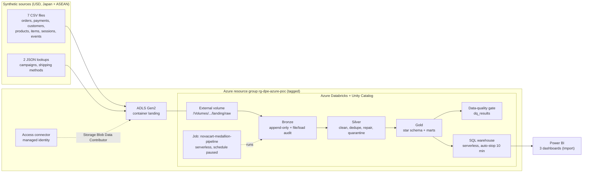

# Architecture — NOVACART_MINI_V2

Flow: files land in ADLS Gen2 → read through a Unity Catalog external volume → one Databricks job runs
Bronze → Silver → Gold → quality gate → Power BI imports Gold through a serverless SQL warehouse.

## Key design decisions

| Decision | Choice | Why |
|---|---|---|
| Ingestion | Scheduled **Databricks job** (notebooks), not Azure Data Factory | Cheaper and simpler: no extra service, one place for code and runs; files are uploaded to the volume |
| Compute | Serverless jobs compute and serverless SQL warehouse (auto-stop 10 min) | No always-on compute; pay per run only |
| Storage access | Unity Catalog storage credential (managed identity) + external location + external volume | No keys or secrets in code |
| New data | New files matching `<entity>_*.csv` in `raw/`; Bronze loads only files not yet loaded | Supports "drop new data and rerun" for the demo |
| Bronze | Append-only, all columns as strings, `_source_file`, `_source_file_modified_at`, `_ingested_at_utc`, `_load_batch_id` | Raw data as received, with lineage |
| Silver | Latest version per business key (later file period wins), standardize statuses/timestamps to UTC, repair keys, quarantine orphans to `silver_rejected_*` | One ID per customer/product; re-loads never duplicate |
| Gold | Full deterministic rebuild from Silver | Idempotent; one grain per table |
| Revenue | Net cash: captured − refunded; failed = 0 | Ties exactly to payments (checked every run) |
| Time zone | Source timestamps have no zone; treated as UTC | Assumption stated for the PoC |
| Power BI mode | Import | Warehouse only runs during refresh → lowest cost |

## Data problems handled in Silver

| Problem in the raw data | Handling |
|---|---|
| Duplicate order records (6 in 2025, 1 re-sent in the demo batch) | Keep one row per `order_id` |
| Mixed timestamp formats (`yyyy-MM-dd` and `MM/dd/yyyy`) | Parse both, store as UTC timestamp |
| Status spellings (`PAID`, `Paid`, `completed`, `Canceled`) | Map to `paid` / `cancelled` / `returned` |
| Blank `customer_id` on orders | Recover from the linked session; otherwise → `silver_rejected_orders` |
| Events with unknown product `P_MISSING` | → `silver_rejected_website_events` |
| Order updated in a later file (late return) | Later file wins |

## Gold tables

See [`data-model.md`](data-model.md) for grains, columns, relationships and RFM rules, and
[`measures.md`](measures.md) for measure definitions (DAX) and the quality checks.

## Next enhancements

- Marketing spend for ROAS; shipment and return data for delivery KPIs.
- Incremental `MERGE` in Silver for larger volumes, Auto Loader for file discovery, freshness checks and alerting, CI/CD for the bundle.
